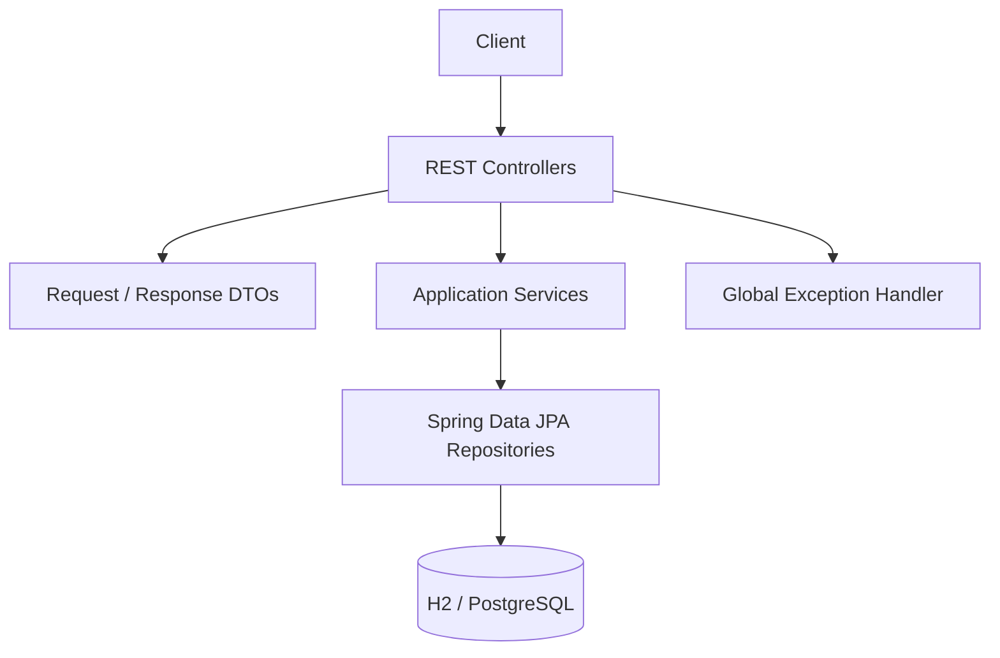

# Architecture

The final application follows a conventional layered design:

Controllers own HTTP concerns; services enforce business rules and transactions; repositories own persistence; DTOs isolate the HTTP contract from persistence entities. Constructor injection is used throughout. Monetary calculations use `BigDecimal`; date/time values use `Instant`/`LocalDate`.
